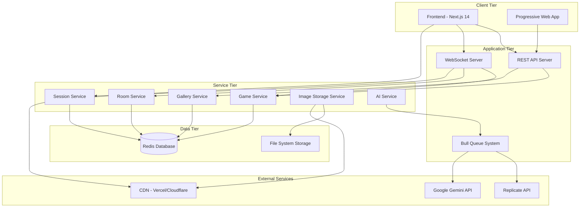
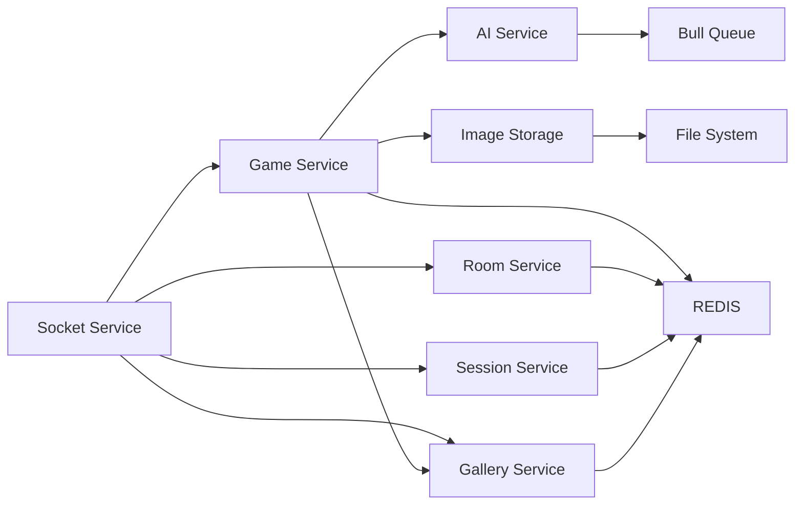
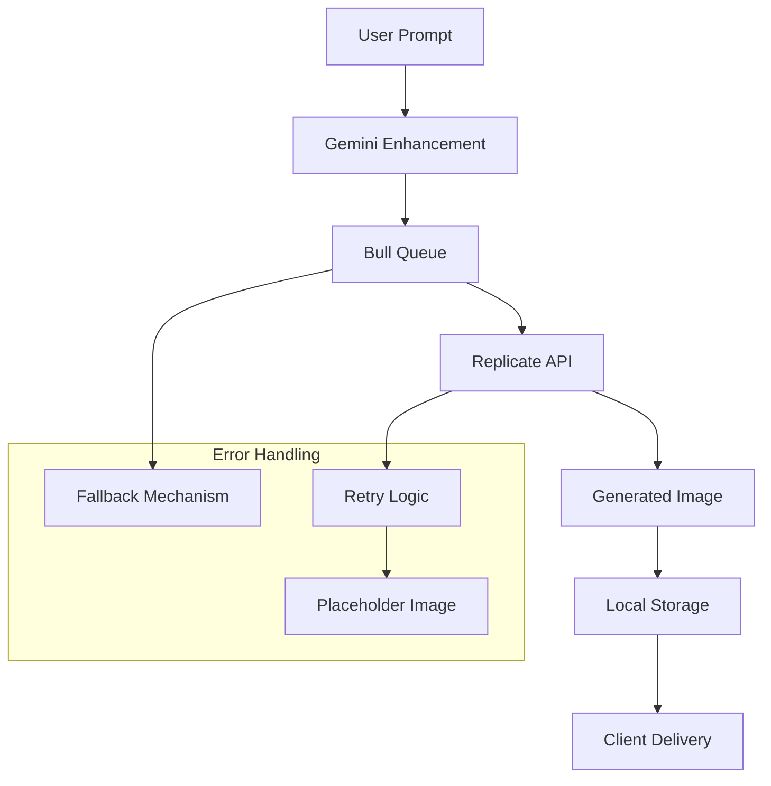
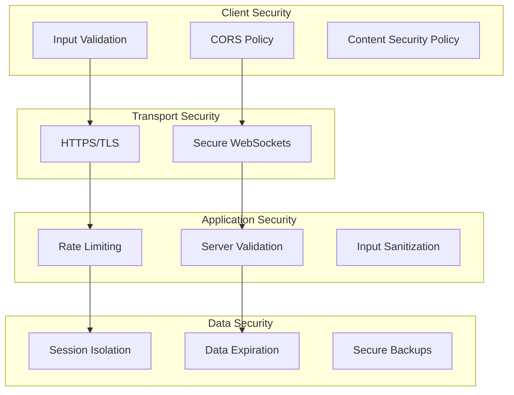
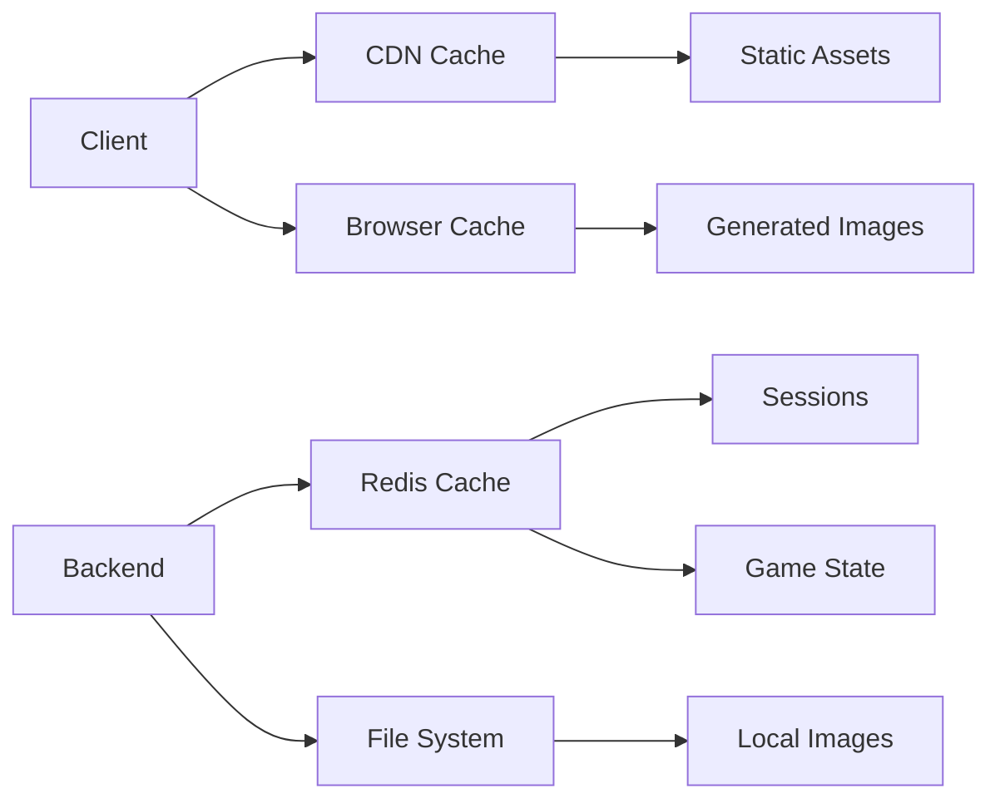
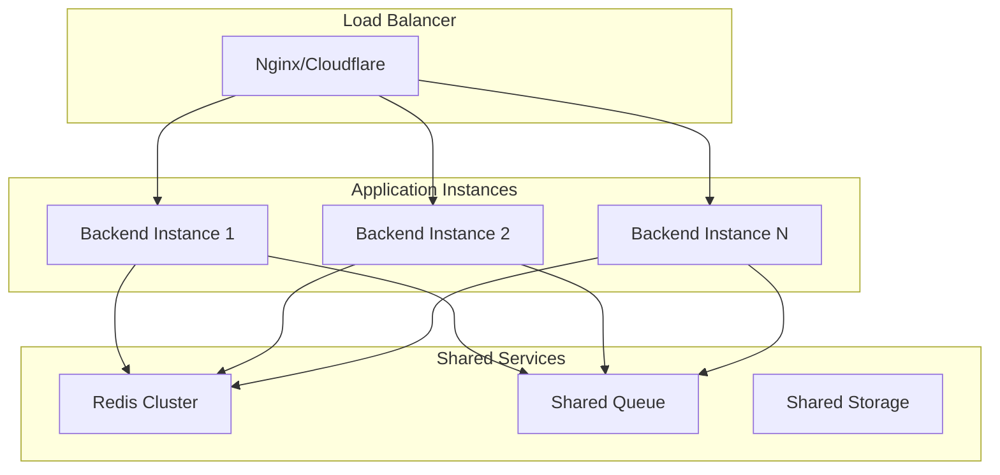
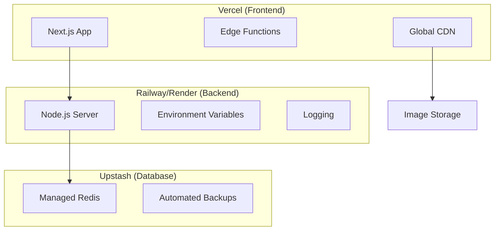
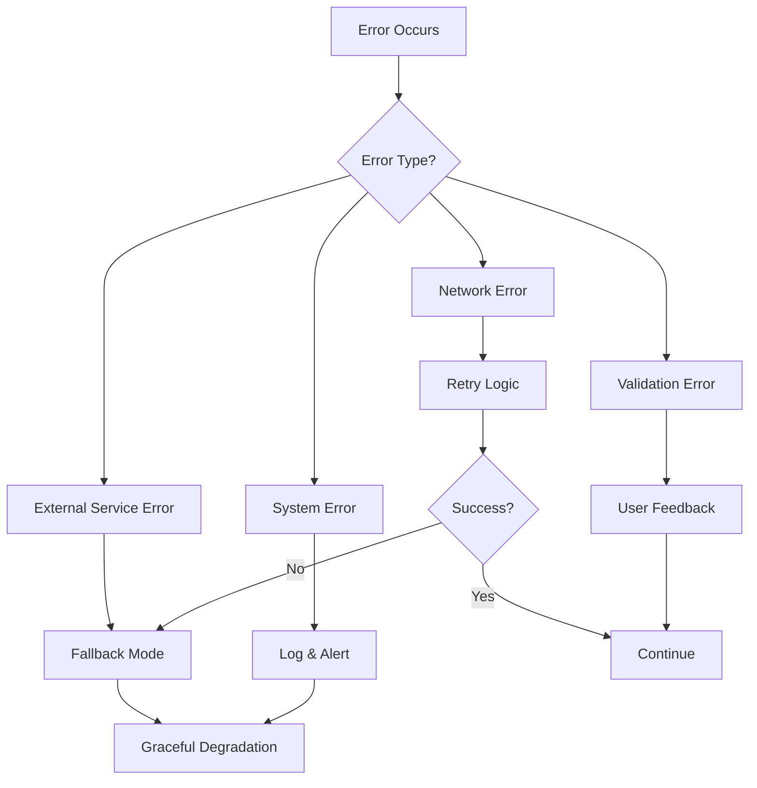
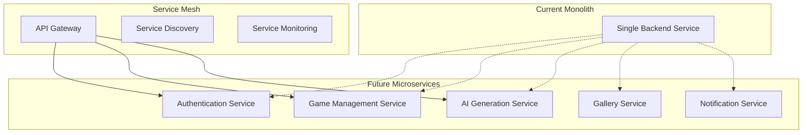

# AiArtBrush System Architecture Document

## 1. Architecture Overview

### 1.1 System Architecture Pattern
AiArtBrush follows a **distributed microservices architecture** with real-time communication capabilities, implementing a **client-server model** enhanced with **WebSocket connections** for live collaboration.

### 1.2 High-Level Architecture Diagram



### 1.3 Architecture Principles
- **Separation of Concerns**: Clear boundaries between frontend, backend, and external services
- **Real-time First**: WebSocket-based communication for immediate updates
- **Stateless Services**: RESTful APIs with session state managed in Redis
- **Fault Tolerance**: Graceful degradation when external services fail
- **Horizontal Scalability**: Design supports scaling across multiple instances

## 2. System Components

### 2.1 Frontend Architecture (Next.js 14)

#### 2.1.1 Application Structure
```
frontend/
├── app/                    # App Router (Next.js 13+)
│   ├── page.tsx           # Landing page
│   ├── results/
│   │   └── page.tsx       # Game results page
│   └── layout.tsx         # Root layout
├── components/            # React components
│   ├── ui/               # Reusable UI components
│   ├── ArtGallery.tsx    # Gallery component
│   ├── ArtworkViewer.tsx # Modal artwork viewer
│   └── StyleSelector.tsx # Art style selection
├── hooks/                # Custom React hooks
│   └── useSocket.ts      # Socket.io client hook
└── lib/                  # Utilities and configuration
    ├── store.ts          # Zustand state management
    └── utils.ts          # Helper functions
```

#### 2.1.2 State Management Architecture
```typescript
// Zustand Store Structure
interface AppState {
  // Socket Connection
  socket: Socket | null
  isConnected: boolean
  
  // Room Management
  room: Room | null
  player: Player | null
  
  // Game State
  currentGame: Game | null
  isMyTurn: boolean
  timeRemaining: number
  
  // UI State
  isProcessing: boolean
  error: string | null
  
  // Actions
  setRoom: (room: Room) => void
  setPlayer: (player: Player) => void
  updateGame: (game: Game) => void
  // ... other actions
}
```

#### 2.1.3 Component Architecture
- **Container Components**: Manage state and business logic
- **Presentation Components**: Handle UI rendering and user interactions
- **Custom Hooks**: Encapsulate reusable logic (socket management, game state)
- **UI Library**: Radix UI components for accessibility and consistency

### 2.2 Backend Architecture (Node.js + Express)

#### 2.2.1 Service Layer Architecture
```
backend/src/
├── index.ts              # Application entry point
├── services/            # Business logic layer
│   ├── socketService.ts  # WebSocket event handling
│   ├── gameService.ts    # Game state management
│   ├── roomService.ts    # Room lifecycle management
│   ├── sessionService.ts # Player session management
│   ├── galleryService.ts # Public gallery management
│   ├── imageStorageService.ts # Local image storage
│   ├── aiService.ts      # AI integration and queue
│   └── redisService.ts   # Database abstraction
└── controllers/         # HTTP request handlers
    └── gameResultsController.ts
```

#### 2.2.2 Service Dependencies


#### 2.2.3 Real-time Communication Layer
```typescript
// Socket Event Architecture
interface SocketEvents {
  // Client -> Server
  'room:create': (settings: RoomSettings) => void
  'room:join': (code: string, nickname: string) => void
  'game:start': () => void
  'prompt:submit': (prompt: string, style: StyleSelection) => void
  
  // Server -> Client
  'room:created': (room: Room) => void
  'room:updated': (room: Room) => void
  'game:started': (game: Game) => void
  'turn:started': (round: Round, playerId: string) => void
  'image:generated': (imageUrl: string) => void
}
```

### 2.3 Data Layer Architecture

#### 2.3.1 Redis Data Model
```typescript
// Key Patterns and TTL Strategy
interface RedisSchema {
  // Room Management
  "room:{roomId}": Room                    // TTL: 1 hour
  "room:code:{roomCode}": string          // TTL: 1 hour
  
  // Game State
  "game:{gameId}": Game                   // TTL: 2 hours
  "game_results:{gameId}": GameResults    // TTL: 7 days
  
  // Session Management
  "session:{socketId}": PlayerSession     // TTL: 1 hour
  
  // Gallery System
  "gallery:{gameId}": GameResults         // TTL: 30 days
  "gallery:index": SortedSet<gameId>      // No TTL
  "gallery:likes:{gameId}": number        // No TTL
  "gallery:featured": Set<gameId>         // No TTL
}
```

#### 2.3.2 Data Consistency Strategy
- **Eventual Consistency**: Real-time updates via WebSocket
- **Single Source of Truth**: Redis for all game state
- **Optimistic Updates**: Frontend updates immediately, server confirms
- **Conflict Resolution**: Last-write-wins for simple conflicts

### 2.4 External Service Integration

#### 2.4.1 AI Service Architecture


#### 2.4.2 Queue Management System
```typescript
// Bull Queue Configuration
interface QueueConfig {
  name: 'ai-generation'
  redis: RedisConfig
  defaultJobOptions: {
    delay: 0
    attempts: 3
    backoff: 'exponential'
    removeOnComplete: 10
    removeOnFail: 5
  }
  concurrency: 5  // Parallel job processing
}
```

## 3. Technology Stack

### 3.1 Frontend Technologies
```json
{
  "framework": "Next.js 14.2.13",
  "runtime": "React 18.3.1",
  "language": "TypeScript 5.0+",
  "styling": "Tailwind CSS 3.4.1",
  "ui_library": "Radix UI",
  "state_management": "Zustand 4.5.2",
  "websockets": "Socket.io Client 4.7.5",
  "icons": "Lucide React 0.378.0",
  "build_tool": "Next.js built-in",
  "deployment": "Vercel"
}
```

### 3.2 Backend Technologies
```json
{
  "runtime": "Node.js 18+",
  "framework": "Express 4.19.2",
  "language": "TypeScript 5.0+",
  "websockets": "Socket.io 4.7.5",
  "database": "Redis (ioredis 5.3.2)",
  "queue": "Bull 4.12.2",
  "validation": "Zod 3.22.4",
  "utilities": [
    "nanoid 5.0.6",
    "cors",
    "dotenv"
  ],
  "deployment": "Railway/Render"
}
```

### 3.3 External Services
```json
{
  "ai_image_generation": "Replicate API (Stable Diffusion XL)",
  "prompt_enhancement": "Google Gemini AI",
  "database": "Redis/Upstash",
  "cdn": "Vercel Edge Network",
  "monitoring": "Built-in logging",
  "analytics": "To be implemented"
}
```

## 4. Security Architecture

### 4.1 Security Layers


### 4.2 Security Measures
- **Input Validation**: Client and server-side validation using Zod schemas
- **CORS Configuration**: Restricted to known frontend origins
- **Rate Limiting**: Prevents abuse of AI generation services
- **Session Isolation**: Each room/game has isolated data space
- **Content Filtering**: AI services have built-in content policies
- **Data Expiration**: Automatic cleanup prevents data accumulation

## 5. Performance Architecture

### 5.1 Performance Optimization Strategies
```typescript
// Frontend Optimizations
interface FrontendOptimizations {
  nextjs: {
    app_router: true,           // Improved routing performance
    server_components: true,    // Reduced client bundle
    image_optimization: true,   // Next.js Image component
    static_generation: false    // Dynamic content requires SSR
  },
  
  react: {
    code_splitting: true,       // Lazy loading of components
    memoization: true,         // React.memo for expensive components
    virtual_scrolling: false   // Not needed for current scale
  },
  
  websockets: {
    connection_pooling: true,   // Singleton socket instance
    event_throttling: true,     // Prevent spam updates
    compression: true          // Socket.io compression
  }
}

// Backend Optimizations
interface BackendOptimizations {
  redis: {
    connection_pooling: true,   // ioredis connection pool
    pipelining: true,          // Batch Redis commands
    compression: false,        // Trade CPU for memory
    clustering: false          // Single instance for now
  },
  
  express: {
    compression: true,         // gzip compression
    static_caching: true,      // Cache static files
    keep_alive: true,         // HTTP keep-alive
    request_timeout: 30000    // 30s timeout
  },
  
  queue: {
    concurrency: 5,           // Parallel AI jobs
    retry_strategy: true,     // Exponential backoff
    job_cleanup: true         // Remove completed jobs
  }
}
```

### 5.2 Caching Strategy


## 6. Scalability Architecture

### 6.1 Horizontal Scaling Strategy


### 6.2 Scaling Considerations
- **Stateless Backend**: All state in Redis enables horizontal scaling
- **Socket.io Adapter**: Redis adapter for cross-instance communication
- **Shared Queue**: Bull queue shared across instances
- **Session Affinity**: Not required due to stateless design
- **Database Sharding**: Redis cluster for larger datasets

## 7. Deployment Architecture

### 7.1 Development Environment
```yaml
# docker-compose.yml structure
services:
  frontend:
    image: node:18
    ports: ["3000:3000"]
    volumes: ["./frontend:/app"]
    
  backend:
    image: node:18
    ports: ["3001:3001"]
    volumes: ["./backend:/app"]
    depends_on: [redis]
    
  redis:
    image: redis:7
    ports: ["6379:6379"]
    volumes: ["redis_data:/data"]
```

### 7.2 Production Environment


### 7.3 Environment Configuration
```typescript
// Environment Variables Schema
interface EnvironmentConfig {
  // Server Configuration
  PORT: number                    // Default: 3001
  NODE_ENV: 'development' | 'production'
  FRONTEND_URL: string           // CORS origin
  
  // Database
  REDIS_URL: string              // Redis connection string
  
  // External APIs
  REPLICATE_API_TOKEN: string    // AI image generation
  GEMINI_API_KEY: string         // Prompt enhancement
  
  // AI Configuration
  AI_STRENGTH: number            // 0.1-1.0
  AI_GUIDANCE_SCALE: number      // 1-20
  AI_INFERENCE_STEPS: number     // 10-50
  
  // Game Configuration
  GAME_MAX_PLAYERS: number       // 2-8
  GAME_ROUNDS_PER_PLAYER: number // 1-10
  GAME_TURN_TIME_LIMIT: number   // 30-300 seconds
}
```

## 8. Monitoring and Observability

### 8.1 Logging Strategy
```typescript
// Logging Architecture
interface LoggingConfig {
  levels: ['error', 'warn', 'info', 'debug']
  
  frontend: {
    console_logging: true,
    error_reporting: 'Sentry',      // Future implementation
    performance_monitoring: true
  },
  
  backend: {
    structured_logging: true,
    log_rotation: true,
    centralized_logging: 'Railway',  // Platform logging
    metrics: ['request_duration', 'error_rate', 'queue_size']
  }
}
```

### 8.2 Health Monitoring
```typescript
// Health Check Endpoints
interface HealthChecks {
  "/health": {
    response: {
      status: 'ok' | 'error',
      timestamp: string,
      version: string,
      services: {
        redis: 'connected' | 'disconnected',
        queue: 'active' | 'paused',
        ai_services: 'available' | 'degraded'
      }
    }
  }
}
```

## 9. Error Handling and Resilience

### 9.1 Error Handling Strategy


### 9.2 Resilience Patterns
- **Circuit Breaker**: Prevents cascading failures from external services
- **Retry with Backoff**: Automatic retry for transient failures
- **Graceful Degradation**: Continue operation with reduced functionality
- **Bulkhead**: Isolate different user sessions and games
- **Timeout**: Prevent indefinite waits for external services

## 10. Future Architecture Considerations

### 10.1 Microservices Migration


### 10.2 Advanced Features Architecture
- **Machine Learning**: Recommendation engine for styles and prompts
- **Real-time Analytics**: User behavior tracking and insights
- **Mobile Apps**: Native iOS/Android applications
- **Blockchain Integration**: NFT creation and ownership
- **Collaborative Editing**: Real-time prompt collaboration

---

**Document Version**: 1.0  
**Last Updated**: August 2025  
**Architecture Review Date**: September 2025