# ART-loop Data Flow Document

## 1. Overview

This document describes the data flow patterns within the ART-loop system, covering user interactions, real-time communication, data persistence, and external service integrations. The system implements an event-driven architecture with real-time synchronization across multiple clients.

## 2. High-Level Data Flow

### 2.1 System Data Flow Diagram

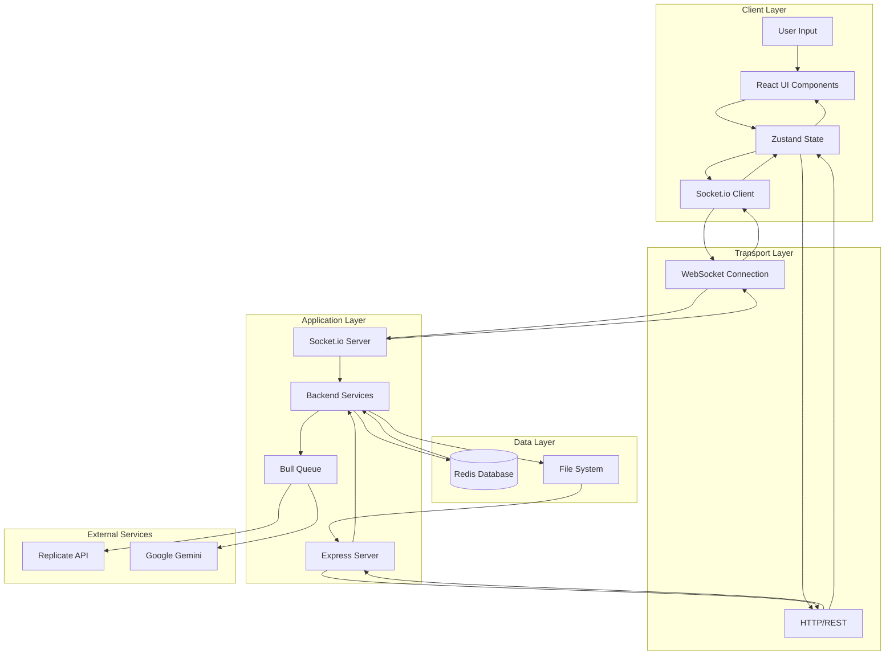

### 2.2 Data Flow Principles

- **Unidirectional Flow**: Data flows in predictable patterns from user input to state updates
- **Event-Driven**: Real-time updates propagate through WebSocket events
- **State Synchronization**: Multiple clients maintain synchronized game state
- **Asynchronous Processing**: Long-running operations (AI generation) handled via queues
- **Persistent Storage**: Critical data persisted in Redis with appropriate TTL

## 3. User Journey Data Flows

### 3.1 Room Creation and Joining Flow

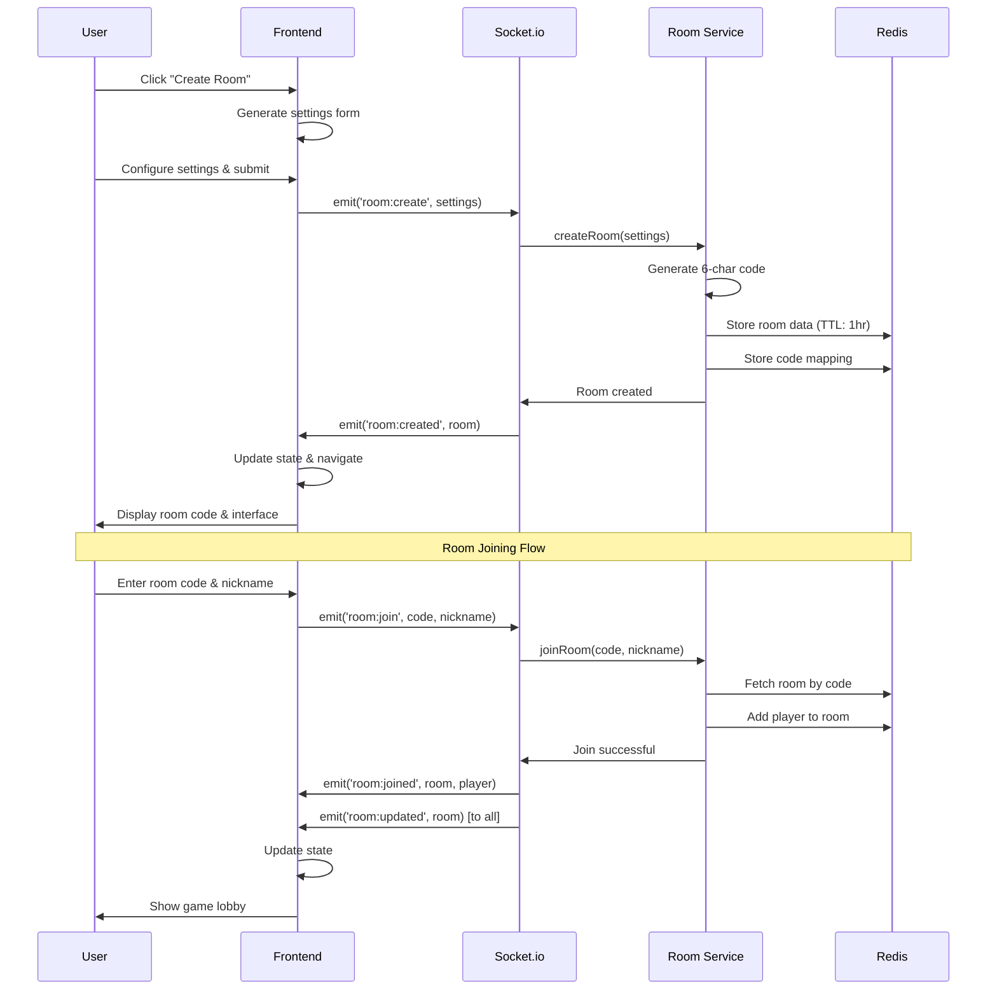

### 3.2 Game Initialization and Turn Management Flow

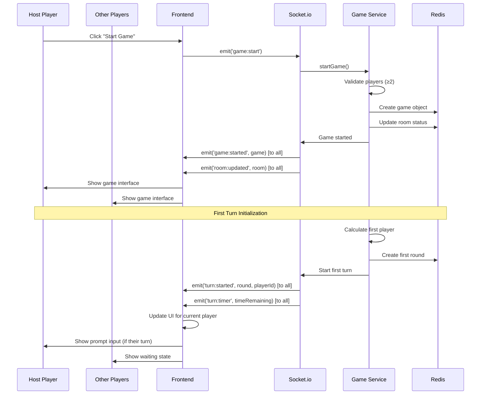

### 3.3 Prompt Submission and AI Generation Flow

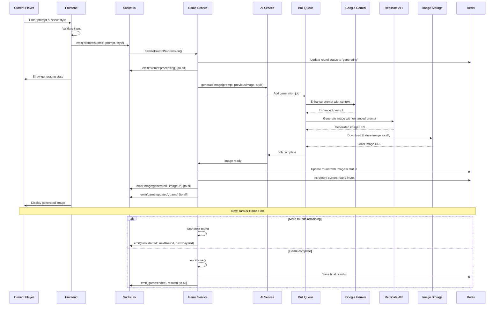

## 4. Real-Time Communication Patterns

### 4.1 WebSocket Event Flow

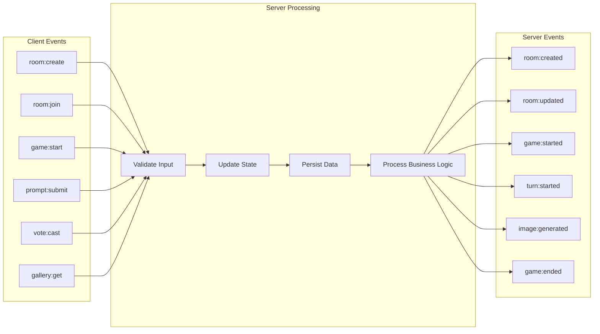

### 4.2 State Synchronization Pattern

```typescript
// Client State Update Flow
interface StateUpdateFlow {
  // 1. User Action
  userAction: () => void
  
  // 2. Optimistic Update (optional)
  optimisticUpdate: (localState: AppState) => AppState
  
  // 3. Server Communication
  serverRequest: (socket: Socket) => void
  
  // 4. Server Response
  serverResponse: (data: any) => void
  
  // 5. State Confirmation/Correction
  stateSync: (serverState: any, localState: AppState) => AppState
}

// Example: Room Joining Flow
const roomJoinFlow: StateUpdateFlow = {
  userAction: () => {
    // User clicks "Join Room"
    setIsJoining(true)
  },
  
  optimisticUpdate: (state) => ({
    ...state,
    isJoining: true,
    error: null
  }),
  
  serverRequest: (socket) => {
    socket.emit('room:join', roomCode, nickname)
  },
  
  serverResponse: (result) => {
    if (result.success) {
      setRoom(result.room)
      setPlayer(result.player)
    } else {
      setError(result.error)
    }
    setIsJoining(false)
  },
  
  stateSync: (serverRoom, localState) => ({
    ...localState,
    room: serverRoom,
    isJoining: false
  })
}
```

## 5. Data Persistence Patterns

### 5.1 Redis Data Lifecycle

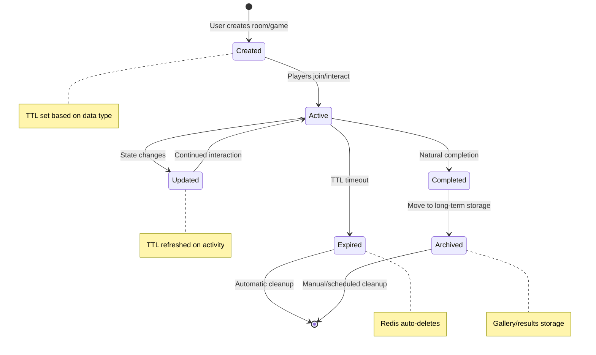

### 5.2 Data Persistence Strategy

```typescript
// TTL Configuration by Data Type
interface TTLConfig {
  rooms: 3600,              // 1 hour - active gaming sessions
  games: 7200,              // 2 hours - extended for generation time
  sessions: 3600,           // 1 hour - player session duration
  roomCodes: 3600,          // 1 hour - matches room TTL
  gameResults: 604800,      // 7 days - downloadable results
  galleryItems: 2592000,    // 30 days - public gallery
  galleryIndex: -1,         // No expiration - permanent index
  likes: -1                 // No expiration - permanent engagement
}

// Data Refresh Strategy
interface DataRefreshPattern {
  onUserActivity: [
    'sessions',     // Extend session on any activity
    'rooms'         // Extend room on player activity
  ],
  
  onGameActivity: [
    'games',        // Extend game on turns/updates
    'rooms'         // Keep room alive during game
  ],
  
  onCompletion: [
    'gameResults',  // Create results with 7-day TTL
    'galleryItems'  // Add to gallery with 30-day TTL
  ]
}
```

### 5.3 File System Storage Pattern

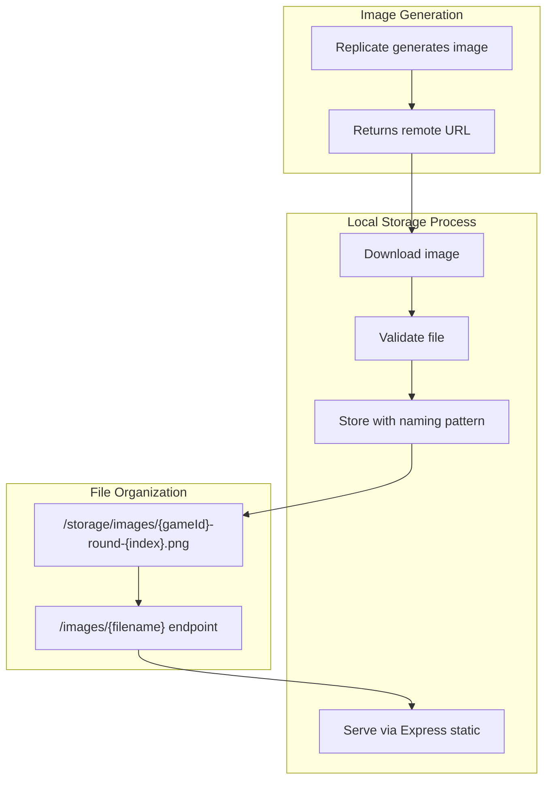

## 6. External Service Integration Flows

### 6.1 AI Service Integration Pattern

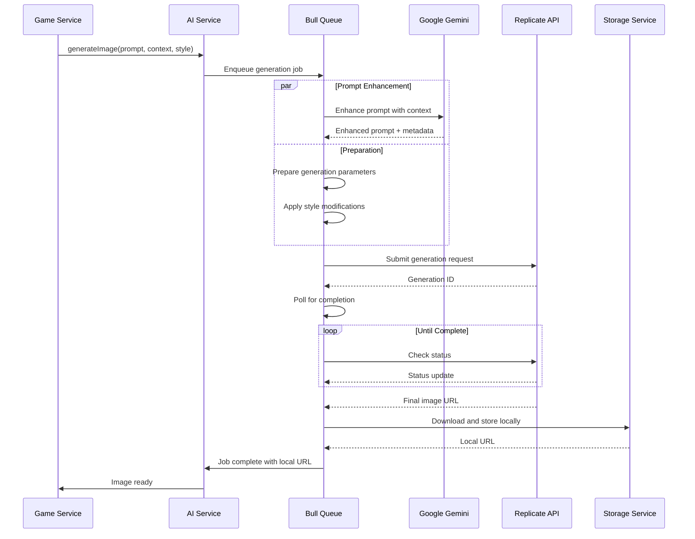

### 6.2 Error Handling and Fallback Flow

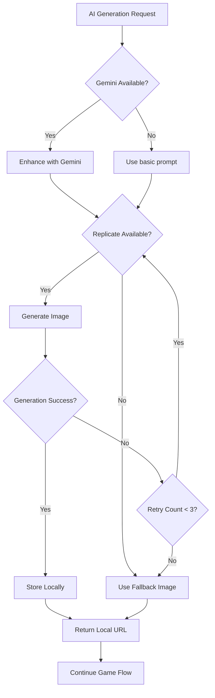

## 7. Performance Data Flow Optimizations

### 7.1 Caching Strategy

```typescript
// Multi-Layer Caching Architecture
interface CachingLayers {
  browser: {
    // Client-side caching
    staticAssets: 'Cache-Control: max-age=31536000',
    generatedImages: 'Cache-Control: max-age=86400',
    apiResponses: 'No caching for real-time data'
  },
  
  cdn: {
    // CDN caching (Vercel/Cloudflare)
    staticFiles: 'Global edge caching',
    images: 'Regional caching with origin pull',
    api: 'No caching for dynamic content'
  },
  
  redis: {
    // Application-level caching
    gameSessions: 'In-memory for active games',
    userSessions: 'Fast session lookup',
    galleryData: 'Cached queries for popular content'
  },
  
  fileSystem: {
    // Local image storage
    generatedImages: 'Permanent local storage',
    thumbnails: 'Generated on-demand (future)',
    backups: 'Periodic backup to cloud storage'
  }
}
```

### 7.2 Data Flow Optimization Patterns

```mermaid
graph TD
    subgraph "Request Optimization"
        BATCH[Batch Operations]
        PIPELINE[Redis Pipelining]
        COMPRESS[Response Compression]
    end
    
    subgraph "Real-time Optimization"
        THROTTLE[Event Throttling]
        DEBOUNCE[User Input Debouncing]
        SELECTIVE[Selective Updates]
    end
    
    subgraph "Storage Optimization"
        TTL[Smart TTL Management]
        CLEANUP[Automated Cleanup]
        SHARDING[Data Sharding]
    end
    
    subgraph "Network Optimization"
        CDN[CDN Distribution]
        COMPRESS2[Asset Compression]
        HTTP2[HTTP/2 Multiplexing]
    end
    
    BATCH --> PIPELINE
    PIPELINE --> COMPRESS
    
    THROTTLE --> DEBOUNCE
    DEBOUNCE --> SELECTIVE
    
    TTL --> CLEANUP
    CLEANUP --> SHARDING
    
    CDN --> COMPRESS2
    COMPRESS2 --> HTTP2
```

## 8. Security Data Flow

### 8.1 Input Validation Flow

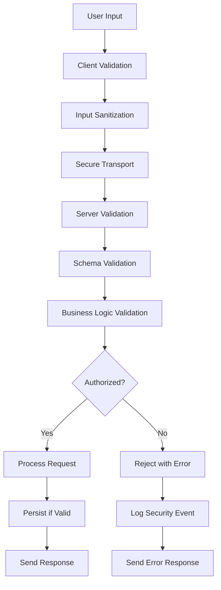

### 8.2 Session Security Flow

```typescript
// Session Security Pattern
interface SessionSecurityFlow {
  creation: {
    sessionId: 'Generated from socket ID',
    validation: 'Validate nickname and room access',
    isolation: 'Isolate session data by room',
    ttl: 'Set appropriate expiration'
  },
  
  validation: {
    onRequest: 'Validate session exists and is active',
    authCheck: 'Verify player permissions for action',
    roomAccess: 'Confirm player belongs to room',
    rateLimit: 'Apply rate limiting per session'
  },
  
  cleanup: {
    onDisconnect: 'Mark session as disconnected',
    onExpiry: 'Auto-remove expired sessions',
    onGameEnd: 'Clean up game-specific data',
    onRoomEmpty: 'Remove room and associated sessions'
  }
}
```

## 9. Monitoring and Analytics Data Flow

### 9.1 Logging Data Flow

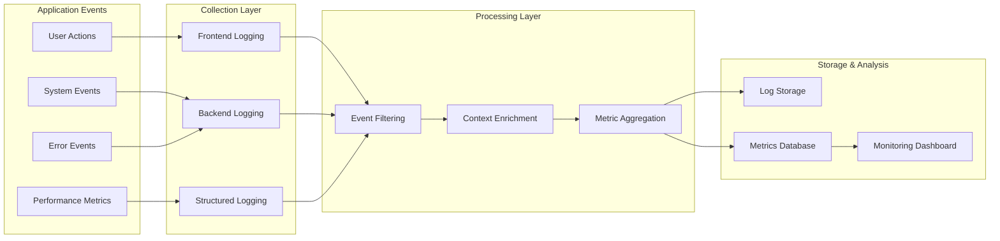

### 9.2 Analytics Event Schema

```typescript
// Analytics Event Structure
interface AnalyticsEvent {
  // Event Identification
  eventType: 'user_action' | 'system_event' | 'error' | 'performance'
  eventName: string
  timestamp: string
  sessionId: string
  
  // Context Information
  userId?: string
  roomId?: string
  gameId?: string
  
  // Event-Specific Data
  properties: {
    // User actions
    buttonClicked?: string
    promptSubmitted?: { length: number, hasStyle: boolean }
    imageGenerated?: { duration: number, success: boolean }
    
    // System events
    roomCreated?: { playerCount: number, settings: RoomSettings }
    gameCompleted?: { duration: number, rounds: number, players: number }
    
    // Performance metrics
    loadTime?: number
    renderTime?: number
    apiResponseTime?: number
    
    // Error details
    errorMessage?: string
    errorStack?: string
    errorContext?: Record<string, any>
  }
}
```

## 10. Data Consistency and Conflict Resolution

### 10.1 Eventual Consistency Pattern

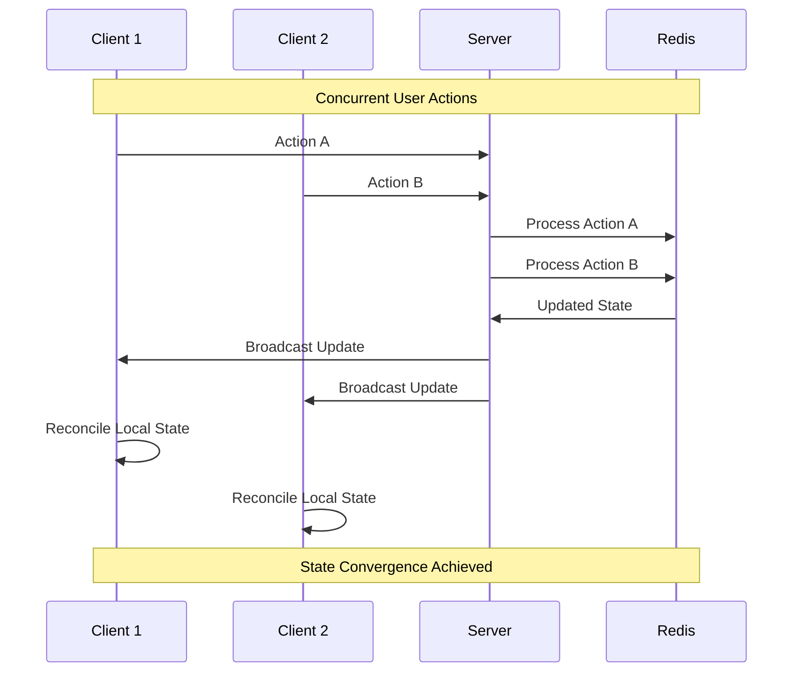

### 10.2 Conflict Resolution Strategies

```typescript
// Conflict Resolution Patterns
interface ConflictResolution {
  roomJoining: {
    strategy: 'First-come-first-served',
    implementation: 'Atomic Redis operations',
    fallback: 'Room full error message'
  },
  
  turnManagement: {
    strategy: 'Server authoritative',
    implementation: 'Single source of truth in Redis',
    validation: 'Reject out-of-turn submissions'
  },
  
  gameState: {
    strategy: 'Last-write-wins',
    implementation: 'Redis atomic updates',
    synchronization: 'Broadcast to all clients'
  },
  
  galleryUpdates: {
    strategy: 'Merge compatible changes',
    implementation: 'Separate counters for likes',
    conflict: 'Independent user actions'
  }
}
```

---

**Document Version**: 1.0  
**Last Updated**: August 2025  
**Next Review**: September 2025